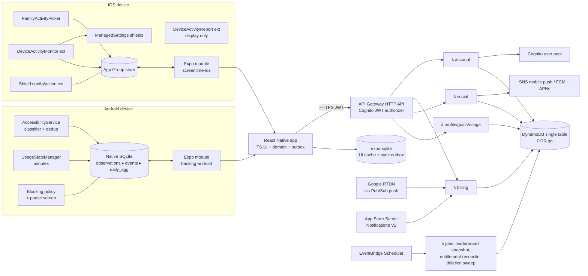

# Architecture — Driftless

> Authentication update (19 October 2026): the user selected Google-only native sign-in instead of Cognito. [Current implementation and setup](GOOGLE_SIGN_IN.md) supersede the identity/Hosted UI sections below.

Status: [PROPOSED] for Phase 0 review · 2026-10-18

## 1. Principles
1. **Native engines own truth.** Counting and restrictions run in Kotlin (Android) and Swift extensions (iOS), with or without the JS runtime, with or without network.
2. **Raw stays local.** Raw observations never leave the device; only consented daily aggregates sync.
3. **Server owns entitlement.** Pro is decided by verified store state, never by the client.
4. **One modular backend.** A single HTTP API, a handful of Lambdas grouped by module, one DynamoDB table.
5. **Honest gaps.** Unavailable tracking is stored as a gap, never as zero.

## 2. System diagram



## 3. Repository layout (D-016)

**`Siddiq3/driftless` — app**
```
app/                        expo-router screens
src/                        api client, auth, local DB (expo-sqlite), UI kit, design-tokens
modules/tracking-android    Expo module (Kotlin): service, classifier, Room DB, blocking
test/                       Jest unit tests
docs/                       product, architecture, threat model, decisions, plans
```
**`Siddiq3/driftless-backend` — backend**
```
packages/contracts          @siddiq3/driftless-contracts: zod v1 schemas, OpenAPI, ./domain
services/api                Lambda handlers (Node 22, TS, esbuild)
infra                       AWS CDK v2 (TS)
```
Contract changes: change + test in backend → bump version → tag `contracts-vX.Y.Z` → app bumps its pinned version.

## 4. Android tracking engine (Kotlin)

Pipeline inside the AccessibilityService process:

1. **Gate:** only events from packages in the supported-app registry are inspected (`packageNames` in service config). All others are ignored at the OS filter level.
2. **Classify surface:** rule set per `(package, versionRange)` → `SHORT_VIDEO | OTHER | UNKNOWN`, with a confidence score.
3. **Fingerprint item:** derive a salted SHA-256 from a minimal stable attribute tuple (e.g. node ID path + content-description length class + creator-handle hash). Plaintext is never stored. Salt is per-install, rotated daily.
4. **Transition detection** (not debounce-only): a transition is confirmed when (a) a pager scroll/state event occurs **and** (b) the fingerprint differs from the last *N* = 8 fingerprints in the session ring buffer **and** (c) dwell ≥ 1.5 s. Returning to a previous item matches the ring buffer → not re-counted.
5. **Persist transactionally:** in one SQLite transaction insert `event(event_id UNIQUE, session_id, seq, …)` and upsert `daily_agg(local_date, package, …)`. `event_id = UUIDv7`; `(session_id, seq)` monotonic; duplicate inserts are no-ops via UNIQUE constraint.
6. **Health:** heartbeat row every 60 s while the service is bound; gaps between heartbeats become `coverage_gap` intervals.

Retention: `event` rows 30 days; `daily_agg` indefinitely (user can wipe). No accessibility node text is persisted.

**Blocking (Pro):** when a blocked package hits its limit, the service starts the app's own `PauseActivity` (clear title, "Open anyway for 5 min", "Settings"). No overlays over system UI, no hiding of Settings, no prevention of uninstall or service disable.

## 5. iOS engine (Swift)
- Main app: authorization, picker, schedules, starting `DeviceActivityCenter` monitoring, App Group writes of `FamilyActivitySelection` (validated before overwrite).
- **DeviceActivityMonitor extension:** stateless; on `intervalDidStart/End` and `eventDidReachThreshold` reads policy from App Group, applies/clears `ManagedSettingsStore` shields, writes tiny status flags (`goal_breached_<date>=true`). Target < 4 MB resident.
- **DeviceActivityReport extension:** renders minutes and charts; no network, no export.
- **Shield configuration / action extensions:** original Wick-themed shield copy; actions `Close app` / `Remind me in 5 min` (if policy allows).
- What syncs from iOS: profile, goals, Wick state, streak booleans *only if* G-5 confirms permissible; otherwise nothing derived from Screen Time leaves the device.

## 6. DynamoDB single-table design

Table `driftless-main`, PK `pk`, SK `sk`, on-demand capacity, PITR enabled, deletion protection, TTL attribute `ttl`.

| Entity | pk | sk | Attributes | TTL |
|---|---|---|---|---|
| Profile | `USER#<sub>` | `PROFILE` | displayName, handle, tz, locale, consentSync, rev | — |
| Handle claim | `HANDLE#<lower>` | `HANDLE` | sub | — |
| Goal | `USER#<sub>` | `GOAL#<goalId>` | type(videos/minutes), target, appsRef, rev | — |
| Daily aggregate | `USER#<sub>` | `DAY#<YYYY-MM-DD>#<platform>` | views, adViews, minutes, coverage(0–1), quality, rev, deviceId | 400 d (configurable) |
| Device | `USER#<sub>` | `DEVICE#<deviceId>` | platform, pushTokenHash, endpointArn, lastSeen | 180 d idle |
| Friend | `USER#<sub>` | `FRIEND#<otherSub>` | status(pending_out/pending_in/accepted), since | — |
| Challenge | `CHAL#<id>` | `META` | ownerSub, metric, start, end, tz, maxMembers | end+90 d |
| Membership | `CHAL#<id>` | `MEMBER#<sub>` | joinedAt, score, scoreRev | end+90 d |
| Leaderboard snap | `CHAL#<id>` | `SNAP#<YYYY-MM-DD>` | ranked list (≤ 50) | end+90 d |
| Entitlement | `USER#<sub>` | `ENTITLEMENT` | tier, source(play/appstore), expiresAt, state, verifiedAt | — |
| Store purchase | `PURCHASE#<store>#<tokenHash>` | `PURCHASE` | sub, productId, state, linkedFrom | — |
| Idempotency | `IDEM#<sub>#<key>` | `IDEM` | requestHash, response, status | 24 h |
| Deletion job | `DELETE#<sub>` | `JOB` | requestedAt, state | 30 d after done |
| Rate counter | `RATE#<sub>#<bucket>` | `RATE` | count | 1 h |

**GSI1** (`gsi1pk`, `gsi1sk`): `MEMBEROF#<sub>` → `CHAL#<id>` (list my challenges); `PURCHASEUSER#<sub>` → purchases (reconcile).

### Access patterns
| # | Pattern | Operation |
|---|---|---|
| AP1 | Get my profile + entitlement + goals | Query `pk=USER#sub`, `sk begins_with` (or BatchGet) |
| AP2 | Upsert day aggregate (idempotent, revision-guarded) | `PutItem` with `ConditionExpression attribute_not_exists(pk) OR rev < :rev` + idempotency record in `TransactWriteItems` |
| AP3 | History range | Query `pk=USER#sub`, `sk BETWEEN DAY#from AND DAY#to~` |
| AP4 | Friend list / requests | Query `pk=USER#sub`, `begins_with FRIEND#` |
| AP5 | Send/accept friend request | `TransactWriteItems` writing both directions, conditioned on existing states |
| AP6 | Challenge members & scores | Query `pk=CHAL#id`, `begins_with MEMBER#` |
| AP7 | My challenges | Query GSI1 `MEMBEROF#sub` |
| AP8 | Leaderboard read | GetItem latest `SNAP#date` (precomputed) |
| AP9 | Resolve store token → user | GetItem `PURCHASE#store#hash` |
| AP10 | Handle uniqueness | Conditional Put on `HANDLE#` |
| AP11 | Account deletion | Query all `USER#sub` items + memberships via GSI1 → batched deletes; job tracked |

Cost assumption: < 10 k MAU, ~1 aggregate write/user/day plus reads → low single-digit USD/month for DynamoDB on demand [ASSUMPTION; measure in Phase 3]. Backups: PITR (35 days) + weekly on-demand backup retained 90 days. Recovery runbook in Phase 7.

## 7. API contracts (v1)

Base: `/v1`. Auth: Cognito access token (JWT) on every route except store webhooks (which verify signatures/OIDC). `sub` from the token is the only owner identifier; no route accepts a user ID for private resources.

| Method & path | Purpose | Notes |
|---|---|---|
| `GET /v1/me` | Profile, entitlement, capabilities | capabilities computed server-side per platform/app version |
| `PATCH /v1/me` | Update profile/prefs | `If-Match: rev` |
| `GET/PUT /v1/goals` | Goals | |
| `POST /v1/usage/sync` | Push daily aggregates | `Idempotency-Key` header; body ≤ 32 KB; ≤ 31 days per call; each day carries `rev` |
| `GET /v1/usage/history?from&to` | History | ≤ 400 days range |
| `POST /v1/friends/requests` | Send request by handle or invite code | rate-limited |
| `POST /v1/friends/requests/{sub}/accept` · `DELETE /v1/friends/{sub}` | Manage | |
| `GET /v1/friends` | List | |
| `POST /v1/challenges` · `POST /v1/challenges/{id}/join` · `GET /v1/challenges/{id}/leaderboard` | Challenges | membership checked |
| `POST /v1/billing/play/verify` · `POST /v1/billing/appstore/verify` | Submit purchase token / signed transaction | server calls store APIs |
| `POST /webhooks/play-rtdn` · `POST /webhooks/appstore` | Store notifications | signature/OIDC verified, no JWT |
| `POST /v1/devices` · `DELETE /v1/devices/{id}` | Push registration | token stored hashed + SNS endpoint |
| `POST /v1/account/delete` · `GET /v1/account/delete` | Deletion request/status | re-auth required (recent `auth_time`) |
| `GET /v1/account/export` | Data export | |

Example schema (in `packages/contracts`, zod):
```ts
export const DailyAggregateV1 = z.object({
  localDate: z.string().regex(/^\d{4}-\d{2}-\d{2}$/),
  tz: z.string().max(64),            // IANA zone at end of that local day
  platform: z.enum(['android', 'ios']),
  deviceId: z.string().uuid(),
  views: z.number().int().min(0).max(5000).nullable(),   // null = not tracked
  adViews: z.number().int().min(0).max(5000).nullable(),
  minutes: z.number().int().min(0).max(1440).nullable(),
  coverage: z.number().min(0).max(1),
  rev: z.number().int().min(1),
});
export const UsageSyncRequestV1 = z.object({ days: z.array(DailyAggregateV1).min(1).max(31) });
```
Errors: RFC 9457 problem+json. Replays with the same `Idempotency-Key` and identical body return the stored response; a different body returns `409`.

## 8. Time & dates
Days are **device-local calendar days** recorded with the IANA zone in effect at day end. A time-zone change mid-day closes the counter under the old zone's date and continues under the new zone; duplicate local dates (travel westward) merge by summing within the same `localDate` key. Server never re-buckets device data.

**Optional floating counter:** the existing AccessibilityService owns `FloatingCountBadge`, a non-focusable/non-touchable `TYPE_ACCESSIBILITY_OVERLAY` showing the current supported app's local daily count. The switch defaults on after counting disclosure/Accessibility is enabled and is stored in TrackingPrefs. Surface recognition, foreground package, lock/interactive state and disclosure gate visibility. Native ticks update it independently of React Native. Service stop, app/player exit, consent withdrawal, screen-off and local wipe remove it. It uses the existing brain raster resource, requires no SYSTEM_ALERT_WINDOW grant, and does not alter classifier validation. Unknown identities show a dash; candidate versions carry `~` and an explicit unconfirmed status.
